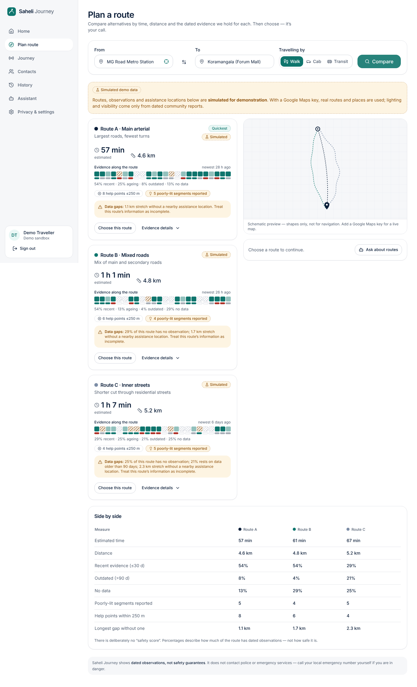

# HerWay Beacon
**Your Journey. Your Choice. Your People.**

A women's travel-safety companion that joins four things in one flow: *route comparison on dated evidence → a consented journey with server-side monitoring → a help request to trusted contacts with tracked acknowledgement → automatic revocation of every contact's access when the journey ends.*

Stack: Next.js 15 (App Router) · TypeScript · Tailwind CSS · shadcn/ui-style components (Radix) · Next.js API routes · PostgreSQL + Supabase Auth (or a zero-config local store) · Google Maps Platform · Meta Model API (Muse) · Web Push.



---

## Quick start (no keys needed)

### Option A: Run with Docker (Recommended)
```bash
docker compose up --build
```
Open [http://localhost:3000](http://localhost:3000) in your browser.

### Option B: Run locally with Node.js
```bash
npm install
npm run dev            # http://localhost:3000
```

Click **Try the demo**. You get a private sandbox with sample contacts and journey history. With no API keys the app runs in a clearly labelled **demo mode**: file-backed store, *simulated* routes/observations, local rules assistant. Everything that is simulated says so in the UI.

Production build: `npm run build && npm start`.

### The 3-minute demo script
1. **Plan route** → pick *MG Road Metro Station* → *Koramangala* → **Compare**. Look at the Evidence Strip, data-gap warnings and the side-by-side table. Open **Ask about routes** (grounded answer with citations).
2. Choose Route B → **Continue to journey setup**. Switch on *Status* for Meera and *Live location* for Anita, turn on **Demo timers**, tick the **pledge**, **Start journey**.
3. **Journey** page: a simulated marker walks the route. A check-in prompt appears (backend-scheduled). Press **Leave the route** to trigger a deviation prompt.
4. Press **Ask for help** → *Send request*. See per-contact, per-channel delivery status. Wait 20 s: the backend escalates to Circle 2.
5. **Contacts** → *Access link* → **Open as Anita** (new tab = the contact's phone). **Acknowledge**, tap *I'm calling her now*. Watch it appear on the traveller screen, labelled "reported by contact, not verified".
6. **End journey** → *I've arrived safely*. The **access receipt** shows what ended; the contact tab flips to "access has been revoked" and no coordinates are returned any more.
7. **History** shows the timeline, consent receipt and an AI/rules summary.

---

## What makes it different

| Idea | What it does |
|---|---|
| **Evidence Strip** | Instead of a "safety score", every route shows 24 segments shaded by *how recent* its observations are (recent / ageing / outdated / no data) with a lighting row beneath. Gaps are first-class. |
| **Journey Pledge** | Before a journey starts you get a plain-language summary of exactly who sees what and when it ends; you must agree. |
| **Access Receipt / Consent Receipt** | After every journey: who had status vs. location, when access began and when it was revoked. |
| **Circles & ripple escalation** | Contacts sit in Circle 1/2/3. Relay notifies Circle 1 first and escalates automatically — on the server — if nobody acknowledges. |
| **Honest delivery tracking** | Each channel shows its true state: *sent → delivered → acknowledged*. SMS/voice is shown as **Simulated — not sent** because no provider is wired in. Contact claims are labelled *reported, not verified*. |
| **Pre-authorised emergency location release** | Optional, explicit: if an *automatic* alert fires, the notified contacts get location until the journey ends. Off by default. |
| **Community observations** | Anyone can add a dated lighting/visibility report to a stretch of route; it feeds the evidence for everyone. |

---

## Requirement map

| Requirement | Where |
|---|---|
| Smart route comparison with dated, labelled evidence; missing/outdated flagged; no guarantees | `src/lib/routing/*`, `components/route-card.tsx`, `components/evidence.tsx` |
| Journey Guardian: ETA, periodic check-ins, deviation prompts with user-controlled responses | `src/lib/journeys.ts`, `src/lib/engine.ts`, `components/journey.tsx` |
| Saheli Relay: call/urgent request, delivery + acknowledgement + reported actions, configurable escalation | `src/lib/relay.ts`, `src/lib/notify.ts`, `components/relay-*.tsx` |
| Live location only to authorised contacts, revoked when the journey ends | `src/lib/grants.ts`, `src/lib/contact-view.ts` (location is *derived from live grants on every request*) |
| AI assistant (Meta Muse), voice, NL requests, summaries, grounded | `src/lib/ai/*`, `components/assistant-chat.tsx` |
| Trusted-contact dashboard | `app/c/[token]`, `components/contact-dashboard.tsx` |
| Journey history + retention | `components/history.tsx`, `engine.purgeExpired` |
| Auth, consent, RBAC, expiring access, secure data, account deletion | `src/lib/auth.ts`, `contact-token.ts`, `crypto.ts`, `account.ts` |
| Backend timers & escalation | `src/lib/engine.ts` + `instrumentation.ts` + `/api/cron/tick` |
| Emergency actions work without AI | Relay & `tel:` buttons use no AI, no maps; urgent phrases bypass the model (`ai/urgency.ts`) |

---

## Architecture

```
Browser (traveller)  ─┐                       ┌─ Google Routes / Places (optional)
Browser (contact)   ──┼─►  Next.js API routes ─┼─ Meta Model API /v1/responses (optional)
Service worker (push)─┘     │                  └─ Web Push (VAPID)
                            ├─ lib/engine.ts  deadline-driven tick (idempotent)
                            └─ lib/store      file store  |  Supabase Postgres
```

### Backend timers & escalation
Every deadline (ETA+grace, check-in window, deviation prompt, relay escalation, grant expiry, retention) is a **timestamp stored on a row**. `tick()` compares them to the clock and is **idempotent** — each transition is guarded by persisted state. It runs from:
- a self-scheduling interval on long-running Node (`instrumentation.ts`, every `TICK_INTERVAL_MS`, default 5 s),
- `GET /api/cron/tick` with `Authorization: Bearer $CRON_SECRET` (Vercel Cron / `pg_cron` / any scheduler) for serverless,
- lazily on every poll.

So a missed check-in escalates even if the traveller's phone is dead or the tab is closed. On multi-instance deployments run the tick from one scheduler.

### Location access that expires
Contacts hold a signed link `contactId.tokenVersion.expiry.hmac` (30-day expiry, revocable by bumping `tokenVersion`). The link grants *no* data by itself: `/api/contact/[token]` recomputes visibility from **active grants** on every request. Ending a journey sets `revokedAt` on every grant and nulls `lastLocation`; a hard cap closes a forgotten journey 6 h after ETA+grace. Verified by the end-to-end test: after ending, the contact response contains no coordinates at all.

### AI grounding
The server turns route data into numbered **facts** (`F1…`). The Meta model must answer JSON `{answer, citations[]}`; the server discards replies that cite nothing, cite unknown ids, or contain safety/emergency claims ("safest", "guaranteed", "police have been called"…) and falls back to a deterministic explainer. Only evidence on screen is sent to the model — never contacts or live location.

Meta Model API: OpenAI-compatible Responses API (`POST {META_API_BASE_URL}/responses`, model `muse-spark-1.3`) — see https://dev.meta.ai/docs/quickstart.

### Data
`src/lib/store` exposes a tiny table API with two drivers:
- **File** (default): `.data/db.json`, atomic writes — demo/local only.
- **Supabase**: set the three Supabase env vars, run `supabase/migrations/0001_init.sql`. Server uses the service-role key; RLS blocks all direct client writes.

---

## Configuration

Copy `.env.example` → `.env.local`. Everything is optional.

| Variable | Enables |
|---|---|
| `APP_SECRET` | Stable session/link signing + field encryption (**set in production**) |
| `NEXT_PUBLIC_SUPABASE_URL`, `NEXT_PUBLIC_SUPABASE_ANON_KEY`, `SUPABASE_SERVICE_ROLE_KEY` | Postgres + Supabase Auth |
| `GOOGLE_MAPS_API_KEY` (server) | Routes API alternatives + Places search/nearby assistance points |
| `NEXT_PUBLIC_GOOGLE_MAPS_API_KEY` (browser) | Google map rendering (otherwise a built-in schematic map) |
| `MODEL_API_KEY`, `META_MODEL` | Meta Muse for explanations, intent parsing, summaries |
| `VAPID_PUBLIC_KEY/PRIVATE_KEY/SUBJECT` (`npm run vapid`) | Web Push to contacts' devices |
| `CRON_SECRET` | Authenticates `/api/cron/tick` |

### Deploying
- **Docker / Container**:
  ```bash
  # Build and start in detached mode
  docker compose up -d --build

  # Check logs
  docker compose logs -f app

  # Stop
  docker compose down
  ```
- **Long-running Node** (Fly, Railway, VPS, container): `npm run build && npm start`. Timers run in-process.
- **Vercel / serverless**: use the Supabase driver, and schedule `/api/cron/tick` every minute. In-process timers don't exist there.

---

## Testing
```bash
npm run build && TICK_INTERVAL_MS=1000 npm start &     # or `npm run dev`
BASE=http://localhost:3000 npm run test:e2e            # ~60 s
BASE=http://localhost:3000 npm run test:e2e:full       # + auto-alert after missed check-ins
```
50 checks cover: auth & CSRF, consent gates, route evidence, grounded AI, location scoping per contact, backend check-in prompts, deviation, relay delivery tracking, tiered escalation, acknowledgement, **revocation on journey end**, link rotation, retention, export and account deletion.

---

## Honest limits (read before relying on it)
- **Not a safety guarantee, and not an emergency service.** The app never says a route is safe and never claims police/ambulance were contacted; "Call 112" is a plain `tel:` link.
- **Simulated in demo mode:** routes, lighting/visibility observations, assistance points, the walking marker, and SMS/voice. With a Google key, routes and nearby police/hospital/pharmacy come from Google; **lighting and visibility exist only as dated community reports** (there is no authoritative public source) — real routes will therefore show many "no data" segments, by design.
- **No SMS/voice provider** is integrated. Add one in `src/lib/notify.ts` (`dispatchToContact`) — the tracker will show real statuses automatically. Until then contacts are reached through the in-app dashboard and Web Push, and invitation links are shared by the traveller.
- **Web Push / Google Maps / Meta API / Supabase paths** are implemented against their public docs but could only be exercised without live credentials in the build sandbox (all fall back gracefully). Test each with your own keys.
- Device GPS is only sent while the journey page is open (browser limitation); timers and escalation continue regardless. A native app or background-geolocation wrapper would remove this limit.
- In-memory rate limiting and the file store are single-process; use Redis/Supabase for scale.
- Security headers are set, but no strict CSP is configured (Next inline scripts + Google Maps); add a nonce-based CSP before production.

## Project layout
```
src/app/            pages + API routes (App Router)
src/components/     UI (ui/ = shadcn-style primitives)
src/lib/            engine, journeys, relay, grants, auth, crypto, routing/, ai/, store/
supabase/           SQL migration with RLS
public/sw.js        push + delivery receipts for contacts
test/e2e.mjs        end-to-end workflow test
```
