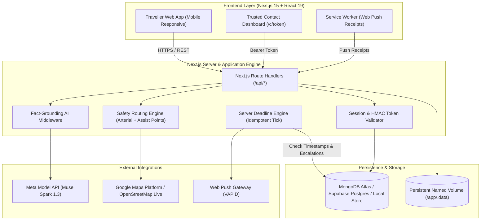
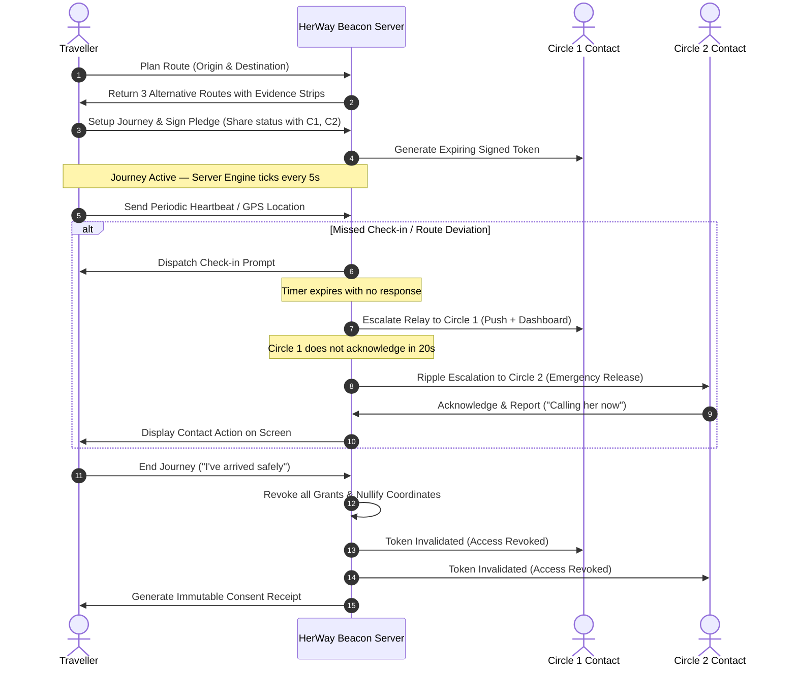

# 🛡️ HerWay Beacon — Meta Developer Hackathon

> **Her Journey. Her Choice. Her People.**  
> A privacy-first, evidence-based travel safety companion designed for women. HerWay Beacon combines dated street-level evidence routing, server-side journey monitoring, tiered emergency relay escalation, and zero-trust location access that revokes instantly when the journey ends.

[](https://nextjs.org/)
[](https://react.dev/)
[](https://www.typescriptlang.org/)
[](https://tailwindcss.com/)
[](https://www.docker.com/)
[](https://dev.meta.ai/)

---

## 📌 Table of Contents
1. [Overview & Problem Statement](#-overview--problem-statement)
2. [Key Innovations & How It Works](#-key-innovations--how-it-works)
   - [Evidence-Based Route Comparison](#1-evidence-based-route-comparison)
   - [Consented Journey Setup & Journey Pledge](#2-consented-journey-setup--journey-pledge)
   - [Journey Guardian & Server-Side Escalation](#3-journey-guardian--server-side-escalation)
   - [HerWay Relay & Ripple Escalation](#4-herway-relay--ripple-escalation)
   - [Zero-Trust Location Revocation & Consent Receipt](#5-zero-trust-location-revocation--consent-receipt)
   - [Meta Muse AI Assistant](#6-meta-muse-ai-assistant)
3. [System Architecture](#-system-architecture)
   - [High-Level Architecture](#high-level-architecture)
   - [Journey Lifecycle & Escalation Flow](#journey-lifecycle--escalation-flow)
4. [Tech Stack](#-tech-stack)
5. [Project Structure](#-project-structure)
6. [Step-by-Step Setup Guide for New Systems](#-step-by-step-setup-guide-for-new-systems)
   - [Method 1: Docker (Recommended)](#method-1-docker-recommended)
   - [Method 2: Native Node.js](#method-2-native-nodejs)
7. [Environment Variables](#-environment-variables)
8. [Interactive 3-Minute Demo Walkthrough](#-interactive-3-minute-demo-walkthrough)
9. [Ethical Design & Safety Principles](#-ethical-design--safety-principles)

---

## 💡 Overview & Problem Statement

Standard navigation platforms optimize solely for **speed and distance**. In doing so, they frequently route pedestrians through poorly-lit back alleys, unmonitored shortcuts, or desolate stretches devoid of assistance locations. Furthermore, existing emergency safety apps demand **all-or-nothing, permanent location sharing**, creating significant privacy and surveillance anxiety.

**HerWay Beacon changes the paradigm:**
- **No False Safety Guarantees:** Instead of a subjective and misleading "safety score", routes are evaluated on **verifiable, dated evidence** (street illumination, arterial road presence, active storefronts, and emergency help points).
- **Consented, Time-Bound Access:** Trusted contacts receive access *only* during an active journey.
- **Instant Revocation:** The millisecond a journey ends, contact access is cryptographically revoked, leaving behind an immutable **Consent Receipt**.
- **Server-Driven Guardian:** Check-in prompts, deviation alerts, and emergency escalations operate entirely server-side, protecting the user even if their battery dies or the browser tab is closed.

---

## 🚀 Key Innovations & How It Works

### 1. Evidence-Based Route Comparison
When planning a route, HerWay Beacon presents alternative paths, each characterized by:
- **The Evidence Strip:** 24 visual segments indicating data freshness:
  - 🟢 **Recent (≤ 30 days):** Verified recent observations.
  - 🟡 **Ageing (31–90 days):** Moderately dated data.
  - 🟠 **Outdated (> 90 days):** Legacy data flagged for caution.
  - ⬜ **No Data:** Explicitly highlighted data gaps (honest reporting).
- **Safety Signals:** Lit road count, percentage on arterial/main roads, commercial storefront density, and assistance locations (police stations, hospitals, pharmacies, 24/7 transit hubs) within 250 meters.
- **Side-by-Side Comparison:** Direct metrics table comparing travel time, distance, lighting status, and longest stretch without help points.

### 2. Consented Journey Setup & Journey Pledge
Before departing:
- Select which **trusted contacts** receive updates.
- Set granular permissions per contact: **Status only** (arrival ETA & check-in state) vs. **Live Location** (real-time coordinates).
- Set proactive check-in frequencies and expected arrival grace periods.
- Sign the **Journey Pledge**: An explicit, plain-language consent agreement defining exactly who sees what and confirming automatic revocation upon arrival.

### 3. Journey Guardian & Server-Side Escalation
- Real-time GPS path verification tracks movement against the planned route.
- If the user leaves the safe corridor, a **Route Deviation Prompt** appears with quick, non-panicking choices ("I took a detour", "I'm in a cab", "I need help").
- Periodic check-in prompts ensure ongoing well-being.
- **Server-Driven Tick Engine:** Deadlines are stored as server-side timestamps. The idempotent engine ticks continuously; if a user misses a check-in or deviation deadline, escalation begins automatically even if the client device loses connectivity.

### 4. HerWay Relay & Ripple Escalation
- If emergency assistance is triggered (manually via "Ask for Help" or automatically via missed check-ins), the system initiates **Ripple Escalation**:
  - **Circle 1 Contacts** are notified immediately via Web Push and in-app contact dashboards.
  - If no acknowledgement is recorded within the escalation window (default 20–30s in demo), the server automatically ripples the alert to **Circle 2 Contacts**.
- Delivery states are tracked honestly: `Sent → Delivered → Acknowledged → Reported Action` ("Calling her now", "En route to location").

### 5. Zero-Trust Location Revocation & Consent Receipt
- Contacts view the journey via unique signed URL tokens (`/c/[token]`).
- The token holds **zero data itself**; the API derives visibility dynamically from **active database grants**.
- The moment the traveler taps **"I've arrived safely"**:
  - All contact tokens are revoked immediately.
  - Any subsequent API request to `/api/contact/[token]` returns zero coordinates.
  - Both traveler and contacts receive an **Access Receipt / Consent Receipt** detailing the exact timestamps when access began and ended.

### 6. Meta Muse AI Assistant
- Integrated with the **Meta Model API (Muse Spark 1.3)**.
- Explains route trade-offs, highlights data gaps, and assists with natural-language planning.
- **Strict Fact-Grounding:** The server converts route metrics into numbered facts. The Meta model is constrained to cite specific facts (`F1`, `F2`) and strictly forbidden from making unverified safety claims.

---

## 🏗️ System Architecture

### High-Level Architecture



### Journey Lifecycle & Escalation Flow



---

## 💻 Tech Stack

| Component | Technology | Description |
|---|---|---|
| **Framework** | Next.js 15 (App Router) | High-performance React framework with standalone output |
| **Frontend** | React 19, Tailwind CSS | Fully responsive UI with custom Mobile App Shell |
| **Icons & UI** | Lucide React, Radix UI | Accessible, clean UI components |
| **Maps & Routing** | Google Routes & Places API / Leaflet OSM | Live high-definition tile map with fallback support |
| **AI Engine** | Meta Model API (`muse-spark-1.3`) | OpenAI-compatible responses API with fact-grounding |
| **Database** | MongoDB Atlas / Supabase PostgreSQL / Local File Store | Multi-driver database abstraction with atomic transactions |
| **Push Notifications** | Web Push (VAPID) | Background notifications for contact alerts |
| **Containerization** | Docker & Docker Compose | Multi-stage lightweight Alpine build (~150 MB) |

---

## 📁 Project Structure

```
Meta-DEV-Hackathon/
├── docker-compose.yml          # Root Docker Compose orchestration
├── .gitignore                  # Global gitignore (protects secrets & node_modules)
├── README.md                   # Complete documentation & guide
└── HerWay Beacon/              # Application Root
    ├── Dockerfile              # Multi-stage production container build
    ├── docker-compose.yml      # Local Docker Compose configuration
    ├── .dockerignore           # Prevents secrets/build artifacts in Docker
    ├── .env.example            # Example configuration template
    ├── package.json            # Node.js dependencies and scripts
    ├── next.config.mjs         # Next.js standalone and security configuration
    ├── tailwind.config.ts      # Tailwind configuration with Meta brand colors
    ├── public/                 # Static assets, logo, icons, manifest, service worker
    ├── src/
    │   ├── app/                # Next.js App Router (pages and API endpoints)
    │   │   ├── api/            # API Route handlers (journeys, contacts, relay, auth)
    │   │   ├── app/            # Protected traveller dashboard (plan, journey, history)
    │   │   └── c/[token]/      # Trusted-contact dashboard view
    │   ├── components/         # Reusable UI components (evidence, map, route-card)
    │   ├── hooks/              # Custom React hooks (usePoll, useNow)
    │   └── lib/                # Backend logic, routing, crypto, engine, AI grounding
    └── test/                   # End-to-end automated test suites
```

---

## 🛠️ Step-by-Step Setup Guide for New Systems

You can run this project on any system (Windows, macOS, Linux) using either **Docker** (recommended) or **Native Node.js**.

### Method 1: Docker (Recommended)

Docker provides a zero-configuration, containerized environment with all dependencies pre-packaged.

#### Prerequisites
- [Docker Desktop](https://www.docker.com/products/docker-desktop/) installed and running.

#### Steps:
```bash
# 1. Clone the repository
git clone https://github.com/aaryansingh200617-cyber/Meta-DEV-Hackathon.git
cd Meta-DEV-Hackathon

# 2. Build and launch the container
docker compose up --build

# Or run in the background (detached mode)
docker compose up -d --build
```

Open **[http://localhost:3000](http://localhost:3000)** in your browser.

#### Useful Docker Commands:
```bash
# View live logs
docker compose logs -f

# Stop the container
docker compose down

# Start up again (instant)
docker compose up -d
```

---

### Method 2: Native Node.js

#### Prerequisites
- Node.js version **20.0.0 or higher** (Node 22 recommended).
- npm version **10.0.0 or higher**.

#### Steps:
```bash
# 1. Clone the repository
git clone https://github.com/aaryansingh200617-cyber/Meta-DEV-Hackathon.git
cd Meta-DEV-Hackathon/"HerWay Beacon"

# 2. Install dependencies
npm install

# 3. Start development server with hot-reloading
npm run dev
```

Open **[http://localhost:3000](http://localhost:3000)** in your browser.

#### Production Build Locally:
```bash
npm run build
npm start
```

---

## 🔑 Environment Variables

The application runs **100% out-of-the-box in Demo Mode without requiring any external API keys**.

To connect live production services, copy `.env.example` to `.env` inside `HerWay Beacon/` and fill in the desired keys:

```bash
cp "HerWay Beacon/.env.example" "HerWay Beacon/.env"
```

| Variable | Description | Default / Fallback |
|---|---|---|
| `APP_SECRET` | 32-byte secret for session signing & HMAC tokens | Auto-generated in demo |
| `MONGODB_URI` | MongoDB Atlas connection string | Falls back to local atomic file store |
| `MONGODB_DB` | MongoDB Database name | `saheli` |
| `GOOGLE_MAPS_API_KEY` | Server-side key for Google Routes & Places API | Falls back to OpenStreetMap & simulation |
| `NEXT_PUBLIC_GOOGLE_MAPS_API_KEY` | Browser key for interactive Google Maps | Built-in interactive Leaflet tile map |
| `MODEL_API_KEY` | Meta Model API Key (Muse) | Grounded deterministic local explainer |
| `META_MODEL` | Meta Model Name | `muse-spark-1.3` |
| `VAPID_PUBLIC_KEY` | Web Push Public Key (generate with `npm run vapid`) | Simulated delivery receipts |
| `VAPID_PRIVATE_KEY`| Web Push Private Key | Simulated delivery receipts |

---

## 🎬 Interactive 3-Minute Demo Walkthrough

Try the core features in under 3 minutes:

1. **Access the Demo:** Open [http://localhost:3000](http://localhost:3000) and click **"Try the demo"**.
2. **Compare Evidence Routes:** Navigate to **Plan Route**. Select starting point and destination (e.g. *Delhi: CP → India Gate*). Notice the 24-segment Evidence Strip, lighting reports, and help points.
3. **Ask Meta Muse AI:** Click **"Ask about routes"** and ask *"Which route has the most reliable lighting?"*. Notice how the response strictly cites on-screen facts.
4. **Setup Journey & Sign Pledge:** Select Route A, configure contact permissions, check the **Journey Pledge**, and start the journey.
5. **Live Tracking:** Open the **Journey** tab to view simulated movement along the route corridor.
6. **Trigger Relay Escalation:** Click **"Ask for help"** → Send emergency request. Watch Circle 1 get notified and observe automated ripple escalation.
7. **Verify Instant Revocation:** Click **"End journey"** → *"I've arrived safely"*. Notice how contact tokens immediately return 0 coordinates, and review the generated **Consent Receipt**.

---

## ⚖️ Ethical Design & Safety Principles

1. **Observations, Not Guarantees:** HerWay Beacon never claims a route is "100% safe" or that emergency authorities have been dispatched unless an actual phone call is initiated.
2. **Privacy by Default:** Location is strictly scoped to the active journey timeframe; contacts cannot track a user before departure or after arrival.
3. **No Surveillance Capitalism:** Contact tokens expire automatically; access receipts provide full audit transparency.
4. **Inclusive Infrastructure:** Functions fully on mobile phones, low-bandwidth networks, and offline fallback modes.

---

### 👨‍💻 Author & Repository
- **Author:** [aaryansingh200617-cyber](https://github.com/aaryansingh200617-cyber)
- **Repository:** [https://github.com/aaryansingh200617-cyber/Meta-DEV-Hackathon](https://github.com/aaryansingh200617-cyber/Meta-DEV-Hackathon)
- **License:** MIT License

